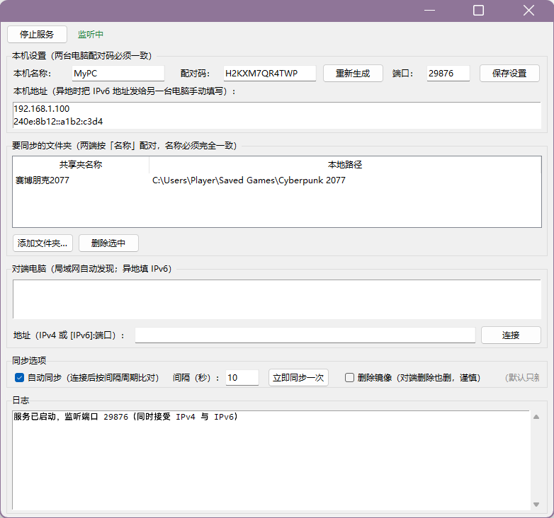

# GameSaveSync

**两台 Windows 电脑的游戏存档自动双向同步工具** · 纯 Python 标准库实现，免安装、无第三方依赖、无云端账号。

[](LICENSE)
[](https://www.python.org/)
[](#)



> A zero-dependency Windows tool that keeps game save folders in sync between two PCs over LAN or public IPv6. Bidirectional, block-level incremental transfer, optional mirror-delete, tray icon. No cloud account required.

---

## 为什么做这个

一台台式机、一台笔记本，同一个游戏在两边轮流玩，存档对不上很烦。Steam Cloud 只覆盖部分游戏，网盘同步会锁文件、会传半截存档，商业同步工具又要装客户端、要账号。

这个工具就做一件事：**两端各跑一个小程序，配对码对上，选好存档文件夹，剩下的事它自己干**。传输先写临时文件再原子替换，游戏永远不会读到写了一半的存档；默认不传播删除，手滑删掉的存档不会同步到另一台。

## 功能

- **局域网自动发现**：同一 Wi-Fi/路由器下自动列出对端，双击即连（IPv4 广播 + IPv6 链路本地组播）。
- **异地 IPv6 直连**：两端都有运营商公网 IPv6 时，填对端地址直连，不需要公网 IPv4、不需要内网穿透、不需要端口映射。
- **双向自动同步**：连接后每 N 秒比对清单，按「最后修改时间优先」（LWW）新覆盖旧，新文件自动补齐。
- **增量传输**：超过 1 MB 的文件先交换 256 KB 分块 MD5 签名，只传变化的块——改一段只传一段（实测 3 MB 存档改 1 块，只传输 8%）。差异过多时自动退回全量。
- **删除镜像（可选，默认关）**：开启后本机删除的文件会同步删除对端同名文件，并清理变空的子目录。
- **托盘最小化**：关闭窗口即缩到系统托盘，后台继续同步；单击恢复窗口，右键菜单可显示/退出。
- **配对码保护**：HMAC-SHA256 挑战应答，配对码不明文上网；端口被陌生人扫到也连不上。
- **WebDAV 云盘备份**：把共享夹自动备份到 Cloudreve、坚果云、Nextcloud 等支持 WebDAV 的网盘，可随时从云端一键恢复，与 P2P 同步相互独立。
- **安全落地**：接收端拒绝 `..` 和绝对路径，防目录穿越；控制消息有长度上限；传输保留原始修改时间。

## 快速开始

### 方式 A：直接运行（需要 Python 3.9+）

```bash
git clone https://github.com/fengshengzhu/GameSaveSync.git
cd GameSaveSync
python run.py
```

安装 Python 时记得勾选 *Add python.exe to PATH*。程序只用标准库，**不需要 `pip install` 任何东西**。

### 方式 B：打包成单文件 exe（推荐给没装 Python 的电脑）

双击 `build.bat`，产出 `dist\GameSaveSync.exe`（约 13 MB），把这**一个文件**拷到两台电脑分别双击即可。

也可以手动执行：

```bash
pip install -U pyinstaller
python -m PyInstaller -F -w -n GameSaveSync run.py
```

### 配对与使用（两台电脑各做一遍）

1. **两端填同一个配对码**：「本机设置」里生成/手抄同一串（12 位，已去掉 0/O/1/I 等易混字符），点「保存设置」。
2. **添加共享夹**：起个名称（如 `赛博朋克2077`），选中本机存档目录。**两端名称必须完全一致**，本地路径可以不同。
3. **连接**：
   - 局域网：对端列表里双击。
   - 异地：把「本机地址」里的 IPv6 发给对方，在地址框填 `[240e:xxxx::1]:29876`（裸 IPv6 也能识别）。
4. 连上后勾选「自动同步」即开始周期比对；也可点「立即同步一次」。

## 网络与防火墙

- **IPv6 前提**：运营商分配了公网 IPv6，路由器开启 IPv6，电脑拿到全局地址（`240e:` / `2408:` / `2409:` / `2602:` 开头，不是 `fe80:`）。
- **Windows 防火墙**：首次启动允许「专用网络」；异地直连若网络被识别为「公用」，需为 `GameSaveSync.exe` 放行入站 TCP 29876。
- **路由器 IPv6 防火墙**：部分路由器默认拦截入站 IPv6，需允许该设备 TCP 29876 入站。
- **时钟同步**：开启 Windows 自动对时。两端时间差过大会导致新旧判断反复（程序内置 2 秒容忍）。
- **别和云存档同时开**：Steam / Xbox / Epic 云存档可能与本工具互相覆盖，建议对目标游戏关闭云存档。

## 同步规则

| 情况 | 动作 |
|---|---|
| 文件只在本地有 | 推送给对端 |
| 文件只在对端有 | 从对端拉取 |
| 两边都有，本地更新 | 本地覆盖对端（大文件走增量） |
| 两边都有，对端更新 | 对端覆盖本地（大文件走增量） |
| 一边删除了文件 | 默认不传播；勾选「删除镜像」后，本机删除会传播到对端 |

- **原子写入**：先写 `*.part` 再 `os.replace`，不会读到半截存档；传输后回写原 mtime。
- **增量传输**：256 KB 分块 MD5，超过 1 MB 才启用，小文件直接全量（更快）。
- **删除镜像的边界**：删除事件在同步轮内通过「前后两次扫描」检测，程序未运行期间发生的删除不会被记录；若对端先推回文件，也可能被恢复。它是「尽力而为」的，重要存档仍建议另做备份。

## 配置文件

首次运行在程序同目录生成 `sync_config.json`（已被 `.gitignore` 排除，**含配对码，不要提交**）。字段示例见 [`sync_config.example.json`](sync_config.example.json)。

| 字段 | 说明 |
|---|---|
| `device_name` | 本机显示名，两端不要相同 |
| `token` | 配对码，两端必须一致 |
| `port` | 监听端口，默认 29876，两端一致 |
| `shares` | `[{name, path}]`，按 `name` 配对 |
| `auto_sync` / `interval` | 自动同步开关与间隔秒数（最小 3） |
| `delete_mirror` | 是否传播删除，默认 `false` |
| `manual_peers` | 手动记录的对端地址 |
| `webdav_*` | 云盘备份配置，见下节 |

## WebDAV 云盘备份（Cloudreve 等）

除了两台电脑互相同步，还可以把共享夹**自动备份到 WebDAV 网盘**（Cloudreve、坚果云、Nextcloud、Alist 等）。它与 P2P 同步相互独立：没有第二台电脑也能单独当云备份用。

### Cloudreve 开启步骤

1. 管理面板 → 用户组 → 编辑你的用户组 → 勾选 **WebDAV 权限**（读写）。
2. 右上角头像 → **WebDAV** → 新建账户，得到用户名和密码（不是登录密码）。
3. WebDAV 地址为 `http://你的Cloudreve地址/dav`。

### 本工具配置

在界面「WebDAV 云盘备份」区填入地址、用户名、密码，勾选「启用」后点「保存」。之后：

- **自动备份**：随同步间隔周期比对本地扫描与已上传状态，只上传有变化的文件（状态记录在程序目录 `webdav_state.json`，首次运行会全量上传）。
- **远端目录**：`<WebDAV地址>/<webdav_dir，默认 GameSaveSync>/<共享夹名>/<相对路径>`，目录自动逐级创建。
- **删除联动**：勾选了「删除镜像」时，本机删除也会删除云端对应文件；默认只增不删。
- **立即备份**：按钮手动触发一次全量比对。
- **从云端恢复**：点「从云端恢复…」选择共享夹，把云端文件下载回本地。两种模式：
  - **仅补齐缺失**（默认，更安全）：只恢复本地没有的文件，本地已有的（哪怕版本更旧）一律不动；
  - **云端覆盖本地**：以云端版本为准，强制覆盖本地所有文件——适合换电脑或存档损坏时整体回滚。
  - 恢复按云端时间戳还原文件修改时间，且会同步更新备份状态，不会被下一轮备份重复上传。

> 提示：坚果云免费版有流量限制（上传 1GB/月）；大体积存档建议用自建 Cloudreve 或 Nextcloud。WebDAV 传输未加密，公网服务器请使用 HTTPS 地址。

## 项目结构

```
GameSaveSync/
├─ run.py                    # 入口
├─ build.bat                 # Windows 打包脚本
├─ sync_config.example.json  # 配置示例
├─ src/
│  ├─ config.py              # 配置读写、本机地址探测、配对码生成
│  ├─ protocol.py            # 长度帧协议、清单扫描、LWW 决策、分块增量
│  ├─ discovery.py           # IPv4 广播 + IPv6 组播发现
│  ├─ engine.py              # 双栈 TCP 监听、HMAC 握手、同步轮、删除传播
│  ├─ webdav.py              # WebDAV 云盘备份（Cloudreve 等，纯标准库）
│  ├─ tray.py                # 系统托盘（纯 ctypes）
│  └─ app.py                 # tkinter 界面
└─ tests/
   └─ test_protocol.py       # 协议与增量重建单元测试
```

## 协议速览

控制消息统一为 `4 字节大端长度 + UTF-8 JSON`，文件内容紧随控制消息之后按流传输。

| 消息 | 方向 | 用途 |
|---|---|---|
| `challenge` / `hello` / `hello_ack` | 握手 | HMAC 挑战应答 + 共享夹名交换 |
| `manifest` | 双向 | 交换某共享夹的文件清单 `{rel: {size, mtime}}` |
| `sig_req` → `sig` | 双向 | 索取对端旧文件的分块 MD5 签名 |
| `push` | 双向 | 推送文件（`delta:1` 时为变化块） |
| `pull` → `file` | 双向 | 拉取文件（带 `basis` 时可回增量） |
| `delete` | 双向 | 删除镜像 |
| `ping` / `pong` | 双向 | 心跳 |

## 测试

```bash
python -m unittest discover -s tests -v
```

全部用例只依赖标准库，任何平台均可直接运行（已在 Windows 与 Ubuntu、Python 3.9 与 3.13 上验证）。

## 常见问题

- **局域网连不上**：确认同一网段、防火墙放行、两端配对码一致，看日志里的拒绝原因。
- **IPv6 连不上**：在被连的电脑访问 `test-ipv6.com` 确认有公网 IPv6；检查路由器 IPv6 防火墙；地址不要带 `%eth0` 这类后缀。
- **想换端口**：两端改成同一端口并保存，重启服务。
- **配对码忘了**：任一端重新生成，另一端改成相同值即可。
- **关了窗口程序还在跑？** 这是托盘最小化，单击托盘图标恢复，右键退出。

## 已知限制

- 仅支持两台电脑之间的同步（更接近「双机镜像」而非多端集群）。
- 只按 mtime + size 判断新旧，不做内容哈希比对；两端时钟偏差大时可能反复互推（内置 2 秒容忍）。
- 删除镜像不持久化墓碑，程序未运行期间的删除不会传播。
- 界面为 tkinter 原生控件，仅保证 Windows 下显示正常。

## 贡献

欢迎 issue 和 PR。改动协议层请一并补 `tests/` 用例；提交前请确认 `python -m unittest discover -s tests` 通过。

## License

[MIT](LICENSE)

---

## English

A dependency-free Windows tool that syncs game save folders between two PCs — over LAN (auto-discovery) or across the internet using public IPv6, no port forwarding or relay server needed.

**Features**

- Auto-discovery on LAN (IPv4 broadcast + IPv6 link-local multicast), manual IPv6 address for remote peers
- Bidirectional sync with last-write-wins, 2 s clock drift tolerance
- Block-level incremental transfer (256 KB blocks, MD5) for files over 1 MB — only changed blocks go over the wire
- Optional mirror-delete (off by default, so a stray delete never wipes the other machine)
- Atomic writes (`*.part` + `os.replace`), original mtime preserved
- HMAC-SHA256 pairing handshake, path-traversal protection on the receiving side
- WebDAV cloud backup (Cloudreve/Nutstore/Nextcloud) — incremental, independent of P2P sync
- Tray icon: closing the window keeps syncing in the background

**Quick start**

```bash
git clone https://github.com/fengshengzhu/GameSaveSync.git
cd GameSaveSync
python run.py            # Python 3.9+, standard library only
```

Or build a single executable: run `build.bat` → `dist\GameSaveSync.exe`.

On both machines: set the **same pairing code**, add a share with the **same name** (local paths may differ), then double-click the discovered peer or enter `[your-ipv6]:29876`. Enable *Auto sync* and you are done.

**Testing**

```bash
python -m unittest discover -s tests -v
```

**Notes** — Windows only (uses `tkinter` + Win32 tray API); IPv6 remote mode requires a global IPv6 address on both ends and an inbound-allowed TCP 29876. Save files are compared by mtime + size, not content hash; keep system clocks in sync (NTP).

MIT licensed.
